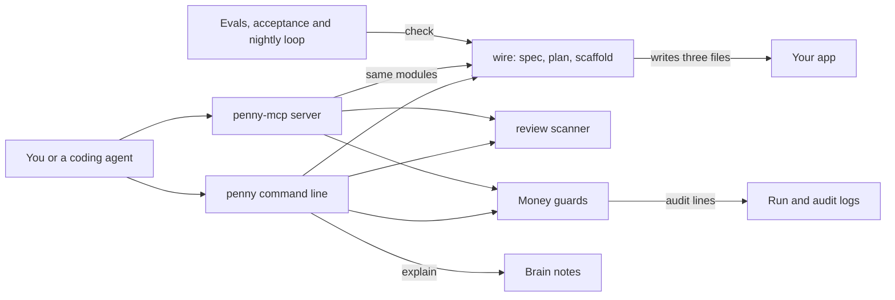

# How Penny works

Penny is a payments helper for developers and coding agents who bill customers with Stripe.
It writes a correct starting point for billing code, reviews existing billing code for known traps, and checks the rules around agent spending.
Its guiding rule is that the ledger is the truth, not the status code.
A ledger here means your own record of what was paid and fulfilled.
Penny works in Stripe test mode and never moves real money.
Most commands are plain code with no model and no network.

## The parts



The command line is [bin/penny.js](../bin/penny.js), which runs the compiled tree from [src/cli/index.ts](../src/cli/index.ts).
It registers one command per module, and it logs every run to `logs/runs.jsonl` through [src/obs/log-run.ts](../src/obs/log-run.ts).
The MCP server in [src/mcp/server.ts](../src/mcp/server.ts) uses the official MCP SDK and offers 8 tools over standard input and output.
MCP, the Model Context Protocol, lets an agent call tools by name.
Its tools in [src/mcp/tools.ts](../src/mcp/tools.ts) reuse the same modules as the command line.
`penny explain` searches the brain, a folder of Markdown notes in [brain/](../brain/), with [scripts/memory-search.sh](../scripts/memory-search.sh).

The `wire` flow lives in [src/wire/](../src/wire/): a spec loader, a step planner and a file writer.
The scanner in [src/review/](../src/review/) checks code line by line against pitfall rules, each with an id such as P-04.
The money guards check a spend token's limits in [src/spt.ts](../src/spt.ts) and keep meter names in [src/wire/meter-registry.ts](../src/wire/meter-registry.ts).
Actions that touch money write a line to `logs/audit.jsonl` through [src/mcp/audit.ts](../src/mcp/audit.ts).
Two Claude Code hooks in [hooks/](../hooks/) block the removed `createUsageRecord` API and warn on a webhook that parses its body first.
The evals in [eval/](../eval/), the tests in [test/](../test/) and the loop in [workflows/rsi.workflow.js](../workflows/rsi.workflow.js) check all of this.

## What happens when you run it

The main flow scaffolds billing from a product spec: `penny wire --product examples/saas-pro.json --target ./billing`.

1. [bin/penny.js](../bin/penny.js) loads `dist/cli/index.js`. Without a build it exits with code 1 and asks you to run `pnpm build`.
2. `main` in [src/cli/index.ts](../src/cli/index.ts) sets an exit hook that logs the run, then parses the arguments with commander.
3. `registerWire` in [src/wire/command.ts](../src/wire/command.ts) calls `loadSpec` in [src/wire/spec.ts](../src/wire/spec.ts).
4. `loadSpec` reads the JSON and validates it with Zod. A bad spec exits with code 1 and names each invalid field.
5. `buildWirePlan` in [src/wire/router.ts](../src/wire/router.ts) orders the steps: scaffold, verify, then self-test. Each step cites a brain id, and a metered price adds a meter step.
6. With `--dry-run`, Penny prints the plan and exits. Nothing touches Stripe and no file is written.
7. With `--target`, `writeScaffold` in [src/wire/scaffold.ts](../src/wire/scaffold.ts) writes three files into the folder.
8. `stripe-client.ts` pins the Stripe API version. `webhook-handler.ts` reads the raw request body before it checks the signature.
9. `fulfill.ts` runs each event id once. It uses an in-memory set that you replace with a unique database row.
10. With neither flag, the command exits with code 2. On exit, the hook appends the run to `logs/runs.jsonl`.

The live checks sit in [test/acceptance/acceptance.test.ts](../test/acceptance/acceptance.test.ts).
They create a real test-mode Checkout Session when `STRIPE_SECRET_KEY` holds a test key, and skip that one check otherwise.
They also verify a signed webhook over raw bytes and replay one event to prove it fulfills once.

## Extending it

- **A command.** Add a module with a `registerX(program)` function in [src/cli/](../src/cli/). Call it in `buildProgram` in [src/cli/index.ts](../src/cli/index.ts).
- **An MCP tool.** Write a schema and a function in [src/mcp/tools.ts](../src/mcp/tools.ts) that reuse an existing module. Register it in [src/mcp/server.ts](../src/mcp/server.ts), then update [test/mcp-contract.test.ts](../test/mcp-contract.test.ts), which expects 8 tools.
- **A review rule.** Add a `PitfallRule` with an id, a severity, a fix and a `detect` function to [src/review/rules.ts](../src/review/rules.ts). Use an id from [brain/KNOWN-PITFALLS.md](../brain/KNOWN-PITFALLS.md).
- **A skill.** Create `skills/<name>/SKILL.md` with `name` and `description` front matter, like [skills/stripe-webhook-correctness/SKILL.md](../skills/stripe-webhook-correctness/SKILL.md).
- **An eval.** Add a Vitest file to [eval/l1/](../eval/l1/) for a plain assertion. For the graded levels, add labelled rows to [eval/labels/l2-golden.jsonl](../eval/labels/l2-golden.jsonl) or [eval/labels/l3-golden.jsonl](../eval/labels/l3-golden.jsonl).

Run these before you push:

```bash
pnpm install
pnpm build
pnpm test
pnpm eval
pnpm eval -- --level l2
pnpm eval -- --level l3
```

## Questions

**Does it need an API key or cost money?**
No key is needed for `wire`, `review`, `debug`, `issue-spt`, `meter`, `check-version`, `explain` or the MCP server.
The acceptance test's Checkout check needs a Stripe test key in `STRIPE_SECRET_KEY`.
`penny webhook listen` needs the Stripe CLI, which you sign in to yourself.
The optional model judge, `tsx eval/l3/run.ts --llm`, needs `ANTHROPIC_API_KEY` and is billed to that key.

**Does any data leave the machine?**
Penny's own source makes no web requests and never calls the Stripe API.
`penny webhook listen` hands off to `stripe listen`, which connects to your Stripe account.
The `--llm` judge sends the labelled examples to Anthropic.
The cockpit in [src/cockpit/server.mjs](../src/cockpit/server.mjs) listens on 127.0.0.1 only, and the logs stay on disk.

**How does it improve itself?**
[dsip.json](../dsip.json) declares the `agent` level, with a nightly loop and no self-grading.
[.github/workflows/rsi.yml](../.github/workflows/rsi.yml) runs `node workflows/rsi.workflow.js --deterministic` every day at 08:00 UTC.
The loop rereads its tool matrix and open gaps. It plants an old API version to prove `check-version` flags it, then runs `pnpm eval`.
It writes a proposal to `.rsi/proposed/`, and CI uploads it for a person to review.
The loop never commits. The model half that would draft fixes stays off unless `CLAUDE_CODE_OAUTH_TOKEN` is set.

**How do I run its tests or evals?**
`pnpm test` runs the Vitest files in `test/` and `eval/`.
`pnpm eval` runs level 1, plain assertions with no network.
`pnpm eval -- --level l2` scores 20 labelled answers and needs an F1 score of 0.8, a standard accuracy measure.
`pnpm eval -- --level l3` scores 12 labelled answers with a rule-based judge and needs a kappa of 0.6, a measure of agreement.
`pnpm test:cockpit` runs the Playwright test for the local cockpit.

**What does it not do?**
It does not move live money or create Stripe objects on its own.
`issue-spt` checks a token's seller, cap and expiry and writes an audit line. It does not call Stripe.
`meter create` records the name locally and refuses a second create. It does not create the meter in Stripe.
`reconcile` explains the diff it would run, and `debug` matches symptoms to known causes. Neither reads your Stripe data.
The review scanner covers only the pitfalls that show up in code, with 8 rules today.
The `penny_wire` MCP tool returns the plan only and writes no files.
